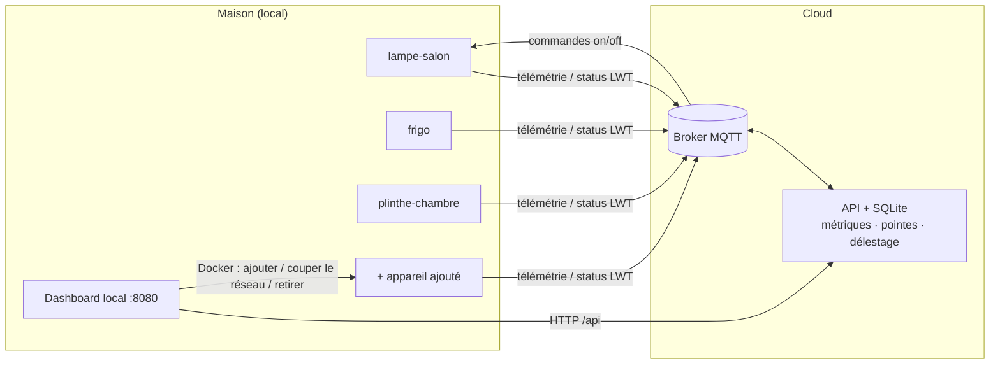

# Axceta Energy — gestion de la consommation électrique à domicile


Des appareils IoT simulés (conteneurs Docker) mesurent le courant sur le fil d'une lampe, d'un frigo,
d'une plinthe… et l'envoient au cloud en MQTT. Le cloud calcule la consommation actuelle, le total du jour
et la consommation pendant les **pointes hivernales d'Hydro-Québec**, puis **déleste** automatiquement les
gros appareils pendant une pointe. Un dashboard local affiche tout en temps réel et pilote les appareils.



## Démarrer (une commande)

Prérequis : Docker Desktop.

```bash
docker compose up --build
```

Ouvrir http://localhost:8080. Trois appareils apparaissent tout seuls.

## Ce que le dashboard montre

| Métrique demandée | Où | Comment c'est calculé |
|---|---|---|
| Consommation actuelle | carte « Actuellement » | somme de la dernière puissance des appareils en ligne |
| Consommation totale par jour | carte « Aujourd'hui » | somme de l'énergie (Wh) depuis minuit, heure de Montréal, avec un coût estimé |
| Consommation pendant les pics de stress | carte « Pendant les pointes » | énergie des mesures prises pendant une pointe (6 h–9 h et 16 h–20 h en semaine, configurable) |

Chaque appareil affiche son état de connexion, sa puissance, son courant, son total du jour et sa version.

## Piloter les appareils simulés

Tout se fait depuis le dashboard :

- **Allumer / Éteindre** : commande envoyée par le cloud en MQTT, comme une vraie prise intelligente.
- **Couper le réseau** : met le conteneur en pause. Le broker ne reçoit plus rien et publie le *Last Will*
  de l'appareil : il passe « Hors ligne » environ 7 s plus tard. **Rétablir le réseau** le reconnecte.
- **Simuler une pointe** : force une pointe. La plinthe (et la borne VÉ) sont délestées, puis rallumées à la fin.
- **Retirer** : arrête le conteneur proprement et le cloud oublie l'appareil (sa consommation passée reste comptée).

Équivalents en ligne de commande : `docker pause axceta-energy-frigo-1`, `docker unpause …`, `docker stop …`.

## Ajouter un appareil

L'appareil **s'enregistre tout seul** : à sa connexion, il publie son type et sa version (message retenu)
et le cloud l'ajoute. Aucune configuration côté cloud.

1. **Dashboard** : choisir un type, puis « Ajouter un appareil ».
2. **Docker** :
   ```bash
   docker run -d --network axceta-energy_default -e DEVICE_ID=borne-garage -e DEVICE_TYPE=ev_charger -l axceta.device_id=borne-garage local/axceta-device
   ```
3. **Permanent** : copier un bloc d'appareil dans `compose.yml`.

Types disponibles : `lamp`, `powerbar`, `fridge`, `heater`, `ev_charger`. Pour un nouveau type, il suffit
d'ajouter une ligne à `PROFILES` dans `device/device.py`.

## Protocole MQTT

| Topic | Sens | Contenu |
|---|---|---|
| `home/<id>/meta` | appareil → cloud, retenu | `{"type", "version"}` |
| `home/<id>/status` | appareil → cloud, retenu, LWT | `online` / `offline` |
| `home/<id>/telemetry` | appareil → cloud, toutes les 2 s | `{"ts", "on", "voltage_v", "current_a", "power_w", "energy_wh"}` |
| `home/<id>/cmd` | cloud → appareil | `{"on": true \| false}` |

Les mesures sont en QoS 1 : pendant une coupure réseau, l'appareil les garde en file et les renvoie à la
reconnexion (store-and-forward).

## CI/CD (`.github/workflows/ci.yml`)

À chaque push :

1. **test** : `ruff`, `pytest` (métriques, pointes, délestage), validation du `compose.yml`.
2. **images** (sur `main`) : build et push des 3 images sur GHCR, taguées `latest` et avec le sha du commit.
   Le sha devient la **version firmware** des appareils, visible dans le dashboard.
3. **deploy** (sur `main`) : copie `cloud/` sur le serveur en SSH et relance l'API avec la nouvelle image.
   Ce job s'active dès que les secrets `DEPLOY_HOST`, `DEPLOY_USER` et `DEPLOY_SSH_KEY` sont définis.

### Déployer le cloud

N'importe quelle VM Linux avec Docker convient (Azure, AWS, GCP, Oracle free tier…) :

1. Ouvrir les ports 1883 (MQTT) et 8000 (API).
2. Si les images GHCR sont privées : `docker login ghcr.io` sur la VM.
3. Ajouter les 3 secrets dans GitHub, puis pousser sur `main`.

### Brancher sur le cloud déployé

Créer un fichier `.env` à la racine :

```env
MQTT_HOST=<ip-du-serveur>
CLOUD_API_URL=http://<ip-du-serveur>:8000
API_TOKEN=<le même jeton que sur le serveur>
```

Puis démarrer seulement la partie maison :

```bash
docker compose up --build dashboard lampe-salon frigo plinthe-chambre
```

## Configuration du cloud

| Variable | Défaut | Rôle |
|---|---|---|
| `PEAK_WINDOWS` | `06:00-09:00,16:00-20:00` | plages de pointe, jours de semaine |
| `SHEDDABLE_TYPES` | `heater,ev_charger` | appareils délestés pendant une pointe |
| `PRICE_KWH` / `PEAK_PRICE_KWH` | `0.07` / `0.50` | tarifs approximatifs, à ajuster à la grille en vigueur |
| `API_TOKEN` | vide | si défini, l'API exige `Authorization: Bearer <jeton>` |
| `TZ_NAME` | `America/Montreal` | fuseau du « aujourd'hui » |

## Choix simplifiés et ce que je ferais en production

- **Broker** : Mosquitto anonyme pour la démo. En production : TLS sur 8883 et un certificat X.509 par
  appareil, ou un service managé (AWS IoT Core, Azure IoT Hub). Le code lit déjà `MQTT_USERNAME`,
  `MQTT_PASSWORD` et `MQTT_TLS`.
- **Stockage** : SQLite avec un verrou global. En production : TimescaleDB ou InfluxDB, avec des agrégats
  horaires et une politique de rétention.
- **Pointes** : plages fixes. En production : s'abonner aux avis d'événements de pointe d'Hydro-Québec, ne
  délester que pendant ces événements, et délester aussi les appareils qui se connectent en pleine pointe.
- **Mises à jour OTA** : la version vient déjà du sha du commit. Prochaine étape : Watchtower, ou une
  commande `update` MQTT, pour que les appareils récupèrent la nouvelle image tout seuls.
- **Temps réel** : le dashboard interroge l'API chaque seconde. Avec beaucoup d'utilisateurs : SSE ou WebSocket.

## Structure

```
device/      appareil simulé (une image, paramétrée par DEVICE_TYPE)
cloud/       broker + API : c'est ce qui est déployé
dashboard/   application locale : interface + relais vers le cloud + pilotage Docker
```
